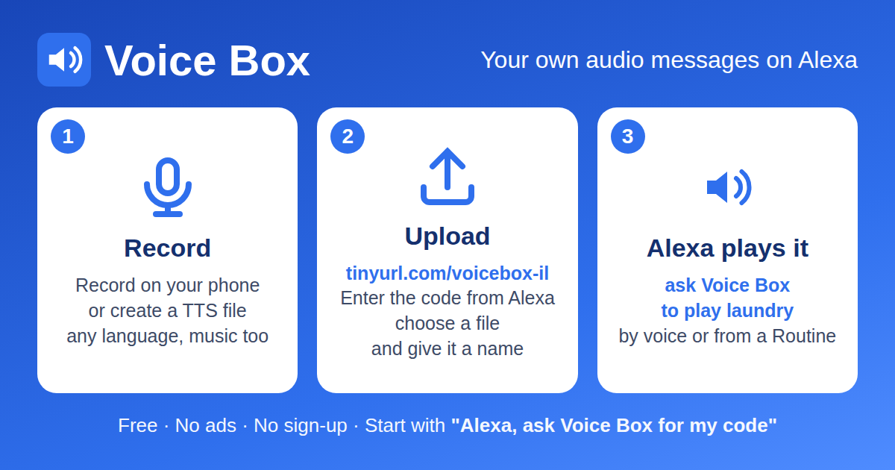

# Voice Box – your own audio messages on Alexa

Upload any audio file (recorded message, TTS in any language, short music clip) and Alexa plays it – by voice or from a Routine. Free, no ads, no sign-up. Built as a replacement for My Pod.

👉 **[Enable Voice Box in the Amazon Alexa store](https://www.amazon.com/dp/B0H8GGHJNB/)** · Upload page: **https://tinyurl.com/voicebox-il**

## How to use
1. Enable the skill and say: **"Alexa, ask Voice Box for my code"** – Alexa says a 6-digit code.
2. Open **tinyurl.com/voicebox-il**, enter the code, pick a file and give it an English name (e.g. `laundry`).
3. Say **"Alexa, ask Voice Box to play laundry"** – or use it in a Routine: *Add action → Customized → "ask Voice Box to play laundry"*.

| Limit | Value |
|---|---|
| Files per user | 20 |
| File size | 3 MB |
| Play length | 4 minutes |
| Formats | MP3, M4A, WAV, OGG, FLAC (converted in the browser) |
| Alexa language | English (US, UK, CA, AU, IN) |

Tip: create routines on a tablet or Echo Show – the Alexa+ phone app may break Customized actions.

## Source
| File | What it is |
|---|---|
| [lambda/skill.py](lambda/skill.py) | Alexa skill Lambda (`VoiceBoxSkill`): pairing code, play via SSML `<audio>` + presigned S3 URL |
| [lambda/web.py](lambda/web.py) | Upload page/API Lambda (`VoiceBoxWeb`, Function URL): pair, list, upload, delete |
| [lambda/index.html](lambda/index.html) | Upload page (Hebrew/English); converts audio to 22050 Hz 48 kbps MP3 with lamejs |
| [models/en-US.json](models/en-US.json) | Interaction model (use the same for en-GB, en-CA, en-AU, en-IN) |

Runs on AWS us-east-1: two Python 3.12 Lambdas, one private S3 bucket and one DynamoDB table (`pk` key, TTL on `ttl`).
Environment variables: `BUCKET`, `TABLE`, `PAGE_URL` (skill only). No secrets are included.
