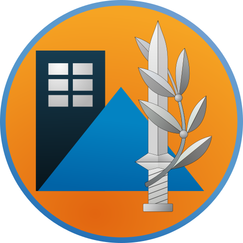

# 🚨 Oref Alert — Pikud HaOref (Home Front Command) alerts for SmartThings

Real-time Israeli Home Front Command alerts in SmartThings — a direct connection to the official alerts feed.
No Tasker, no Samsung Modes & Routines tricks, no MacroDroid, no phone in the loop.

### Features
- **Alert state** for your area: `safe` / `preAlert` / `alert` / `ended`
- **Status tile** with the official alert title (rockets, UAV, etc.)
- **Time to shelter** for your area
- **Last alert** time and description
- **Contact sensor** (open = active alert) for simple Routines
- Hebrew / English tile labels

### How it works
- A poller in AWS Tel Aviv (`il-central-1`) checks the Oref alerts feed every 2 seconds — one request for all users
- Automatic fallback to the Tzofar feed if Oref is unreachable
- Changes are pushed to SmartThings within seconds via Schema Connector callbacks
- Runs entirely within the AWS free tier

### Install
1. Open the invite link (see the [main README](../../README.md#schema-connectors-cloud-aws-lambda)) on your phone
2. Accept and select your home location in SmartThings
3. Your alert area is auto-detected from the location's address — confirm or pick another from the list
4. A device named **"פיקוד העורף - &lt;area&gt;"** is created

> Your SmartThings location must have an address set for auto-detection to work.

### Routine ideas
- Turn on all lights when **Alert State = Alert** (or contact sensor = Open)
- Open motorized shutters
- Pause music / turn off the TV
- Announce on a smart speaker

### ⚠️ Disclaimer
This integration **supplements, and does not replace**, the official Home Front Command app and sirens.
It is unofficial and not affiliated with the IDF Home Front Command. Always keep the official app installed and active.
